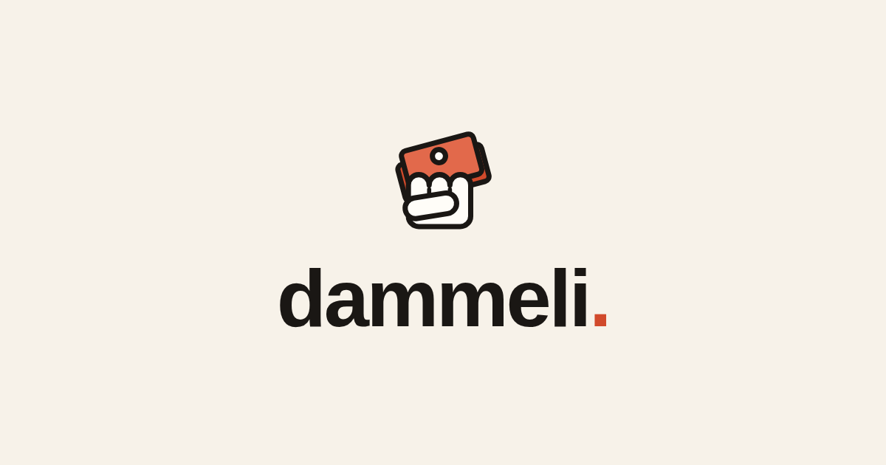

Getting paid back by a friend usually means a screenshot of your IBAN, a *"which app do you even have?"* back-and-forth, or digging up some old payment link from months ago.

**dammeli** is one link that holds every way you accept money — Satispay, Revolut, PayPal, bank transfer, whatever else you use. You send it once, whoever's paying picks what works for them.

The twist: your page is **encrypted in your own browser** before anything leaves it. The server only ever stores an unreadable blob. No account, no email, nothing tracked. Not even I can read what's on your page.

---

## How it works

1. Add the payment methods you already use.
2. They're encrypted on your device — the key never leaves your browser.
3. Share the link: the key travels inside the URL fragment (`#...`), which browsers never send to the server. No key, no page.

## Under the hood

- **AES-GCM** with keys derived from a 128-bit secret generated by `crypto.getRandomValues`
- Separate **read** and **edit** links: the read link can decrypt, but can't modify
- Every page is padded to exactly **4096 bytes**, so the server can't even guess how many methods you have
- All the cryptography lives in a single `public/crypto.js`, served **byte-identical** to the repo: anyone can diff it
- Strict CSP, **zero external resources**: no CDN, no remote fonts, no trackers
- A link created today must keep opening **forever** — every format version stays readable

## Features

- [x] Satispay, Revolut, PayPal, IBAN + up to 5 custom methods
- [x] Paste-tolerant inputs (full PayPal URLs, IBANs with spaces...)
- [x] QR code generated locally
- [x] Share on WhatsApp in one tap
- [x] "Your pages" list, saved only on your device
- [x] Dark mode 🌗
- [x] Italian, English and Spanish 🇮🇹 🇬🇧 🇪🇸

## Tech Stack

- **Frontend:** Astro (fully static), Tailwind v4, no JS framework
- **API:** Netlify Functions
- **Database:** Supabase (it only sees encrypted noise)
- **Hosting:** Netlify

Still in private beta (`0.9`) — PRs and feedback welcome!
